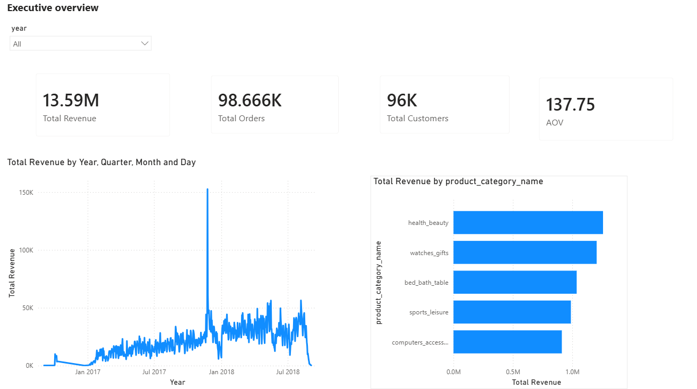
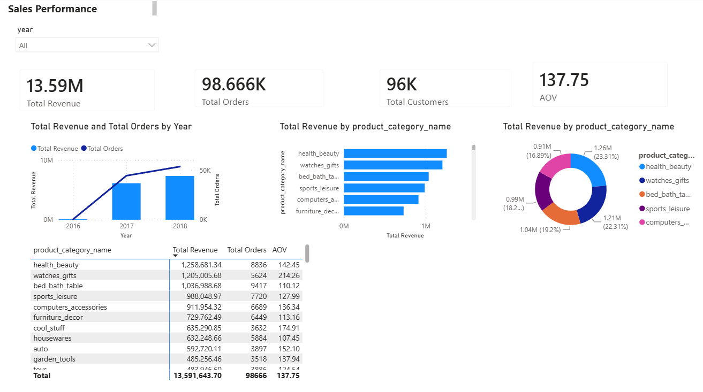
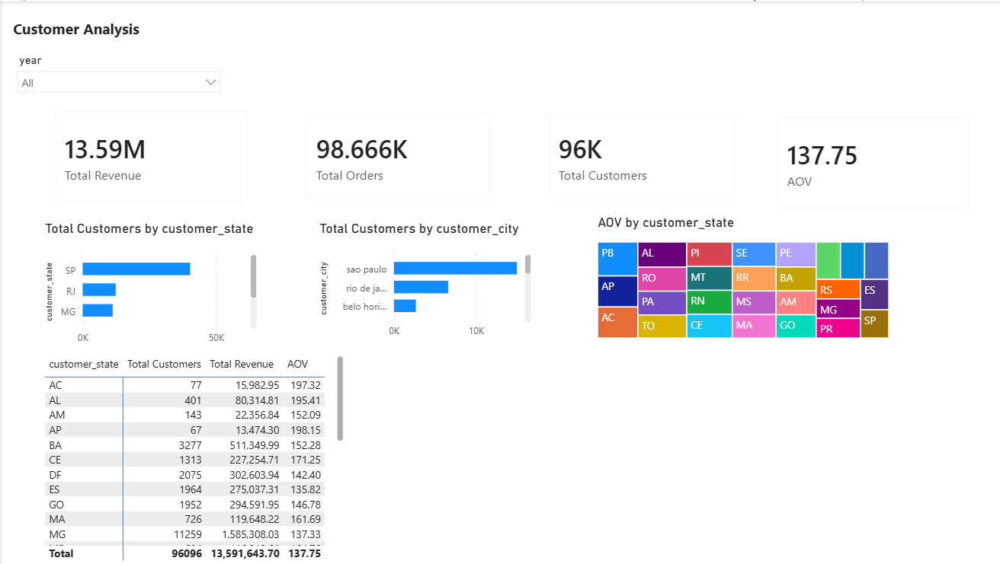
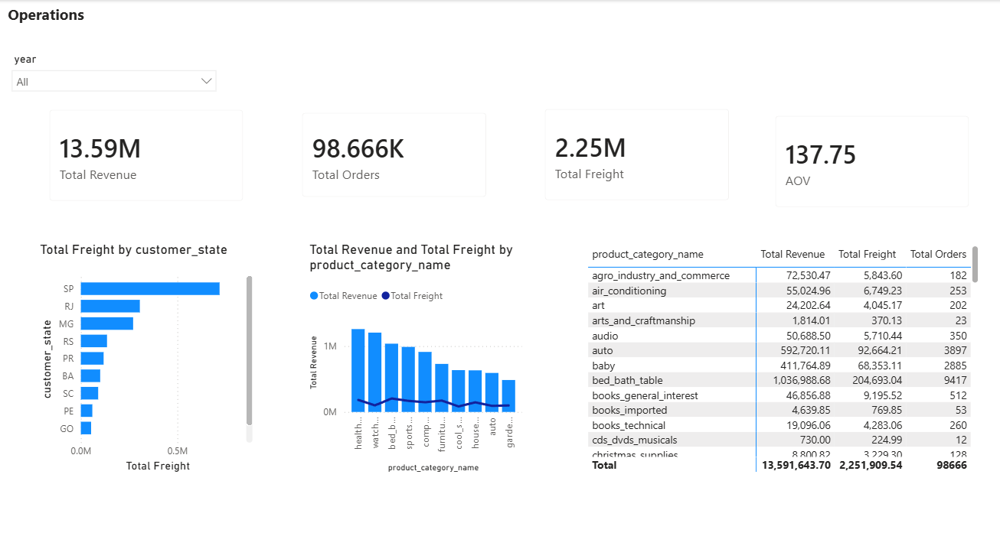

# Olist E-Commerce Analytics & Business Performance Report

This repository contains an end-to-end data analytics project based on the Brazilian Olist E-Commerce dataset (~100k transactions from 2016 to 2018). The project includes PostgreSQL database setup, Star Schema data modeling, custom SQL analytical scripts, and a 4-page interactive Power BI dashboard.

---

## Executive Summary & Consulting Report

1. Problem Statement
Olist connects small independent merchants across Brazil with large online marketplaces. Rapid growth brought several operational and decision-making challenges for executive leadership:
- Revenue Visibility: Difficulty separating seasonal sales spikes from steady long-term growth.
- Logistics Costs: High freight rates and longer delivery windows in non-metropolitan regions affecting customer conversion.
- Category Performance: Limited insight into which product lines drive actual revenue versus those that simply create operational volume.

This project delivers a structured data warehouse model and an interactive dashboard to give sales, operations, and leadership teams actionable metrics for better forecasting and logistics planning.

2. Data & Architecture
The original dataset consists of raw transactional files containing order statuses, product attributes, customer locations, payments, and freight fees.

To ensure fast query performance and reliable cross-filtering in Power BI, the relational data was structured into a clean Star Schema:
- Fact Table (`fact_orders`): Contains line-item transaction metrics, product pricing, and freight costs.
- Dimension Tables:
  - `dim_date`: Time intelligence attributes (Year, Quarter, Month, Day).
  - `dim_customer`: Geographic fields (State, City) and unique customer identifiers.
  - `dim_product`: Translated category names and product specs.

3. Methodology
a) Data Preparation & ETL: Cleaned raw records in PostgreSQL, mapped foreign keys, and normalized product category names.
b) Data Modeling: Built 1-to-many single-direction relationships between dimension tables and the core fact table in Power BI.
c) Exploratory Data Analysis (SQL): Wrote SQL scripts for RFM customer segmentation, quarterly revenue aggregation, and category ranking.
d) Dashboard Development: Created a 4-page Power BI report using dedicated DAX measures for core business KPIs.

4. Key Findings
- Regional Concentration: The state of São Paulo (SP) is the primary operational hub, generating over 40% of total order volume and net revenue.
- Product Performance: Categories like Health & Beauty and Bed Bath Table lead total order volume, whereas technical categories like Computers & Accessories drive the highest Average Order Value (AOV).
- Freight Impact: Shipping fees make up a disproportionately high percentage of the total purchase price in Northern and Northeastern states, dampening sales growth outside the Southeast region.

5. Strategic Recommendations
a) Decentralized Logistics: Establish regional fulfillment hubs outside São Paulo to lower freight costs and speed up delivery times for Northern buyers.
b) Product Bundling: Implement multi-item bundles for lower-priced categories to increase cart size and offset shipping costs.
c) Targeted Expansion: Focus marketing acquisition campaigns on high-potential secondary markets like Rio de Janeiro and Belo Horizonte.

6. Limitations
- Historical Scope: The analysis uses static historical data ending in 2018 without real-time API integrations.
- Data Granularity: The dataset lacks internal seller profit margins and customer acquisition costs (CAC), limiting profit margin evaluation.
- Anonymized Customer Profiles: Customer IDs are anonymized, preventing demographic profiling by age or income group.

---

## Dashboard Preview

Executive Overview

Sales Performance

Customer Analysis

Operations & Logistics

---

## KPI Metrics Dictionary

| Metric | DAX / Logic | Description | Business Purpose |
| :--- | :--- | :--- | :--- |
| Total Revenue | `SUM(fact_orders[price])` | Sum of item sales prices | Tracks gross sales volume excluding shipping charges. |
| Total Orders | `DISTINCTCOUNT(fact_orders[order_id])` | Count of unique order IDs | Measures order throughput and overall demand. |
| Average Order Value (AOV) | `DIVIDE([Total Revenue], [Total Orders], 0)` | Total Revenue / Total Orders | Evaluates average customer spend per transaction. |
| Total Customers | `DISTINCTCOUNT(dim_customer[customer_unique_id])` | Count of unique buyer IDs | Tracks overall active customer reach without duplicate order counts. |
| Total Freight | `SUM(fact_orders[freight_value])` | Sum of shipping charges | Aggregates shipping fees across all transactions and regions. |

---

## Repository Structure

- `01_sales_over_time.sql`: Quarterly and monthly revenue aggregation queries.
- `02_product_analysis.sql`: Category performance and volume ranking scripts.
- `03_customer_analytics.sql`: RFM segmentation and customer retention analysis.
- `create_analytical_model.sql`: DDL script for table structures and Star Schema setup.
- `olist_analytics_dashboard.pbix`: Main Power BI Desktop file.
